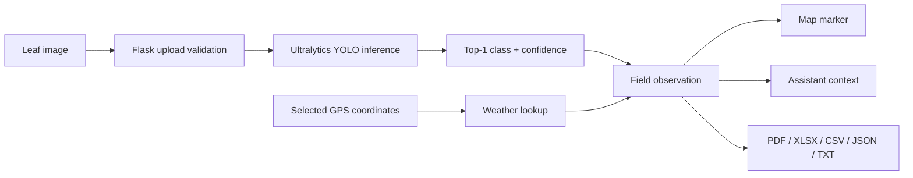

<div align="center">

# 🌿 SYMBIOSIS

### Drone-Based Banana Crop Health Intelligence

**AI-assisted leaf classification, field mapping, weather-risk context, and practical crop guidance in one responsive workspace.**

[](https://www.python.org/)
[](https://flask.palletsprojects.com/)
[](https://www.ultralytics.com/)
[](https://maplibre.org/)
[](#license)

</div>

---

## Overview

SYMBIOSIS is a web-based precision-agriculture application for screening banana leaves and organizing observations by location. A trained Ultralytics YOLO classification model analyzes uploaded images and assigns one of four known labels. The application then combines that prediction with plantation coordinates and available weather conditions to provide richer field context.

The interface supports single-image and batch analysis, MapLibre-based result visualization, an agriculture-focused assistant, speech playback, and exports in PDF, Excel, CSV, JSON, and text formats. The formal PDF export summarizes findings as a crop-health area assessment.

> **Important:** SYMBIOSIS is a screening and early-warning tool. It does not replace laboratory diagnosis, field inspection, or advice from a qualified agronomist or plant pathologist.

## Core Features

- **Banana leaf classification** using local `models/best.pt` YOLO weights
- **Four output labels:** Healthy, Cordana, Pestalotiopsis, and Sigatoka
- **Single and batch processing** for individual captures or image sets
- **Geospatial observations** plotted on an interactive MapLibre map
- **General Santos City default map view** with dark, light, and field-oriented basemaps
- **Weather-risk enrichment** using current conditions for selected coordinates
- **Field assistant** with detection context, local fallback behavior, and text-to-speech
- **Formal assessment exports** in PDF, XLSX, CSV, JSON, and TXT
- **Responsive interface** for desktop and mobile field use
- **Input validation** for coordinates and uploaded image formats

## How It Works



1. User selects plantation coordinates and uploads one or more supported images.
2. Flask validates coordinates, file extensions, and request structure.
3. Local YOLO weights classify each image and return top-ranked class and confidence.
4. Current weather is requested when Visual Crossing credentials are configured.
5. Result is shown in workspace, added to map, and made available to assistant and exports.

### Understanding Model Output

A confidence score describes model certainty among four learned classes. It does **not** represent percentage of leaf area damaged. Current classification weights do not calculate lesion-area severity. Serious or spreading cases should be verified in field.

## Technology Stack

| Layer | Technologies |
|---|---|
| Backend | Python, Flask, Gunicorn, Werkzeug |
| Machine learning | Ultralytics YOLO, PyTorch runtime, ONNX Runtime, NumPy |
| Frontend | HTML5, CSS3, vanilla JavaScript, Jinja templates |
| Mapping | MapLibre GL JS, OpenFreeMap styles |
| Motion and 3D | GSAP, `<model-viewer>` |
| Reports and data | jsPDF, SheetJS |
| Weather | Visual Crossing Weather API |
| Assistant | Groq-compatible chat completions API with local fallback |
| Speech | Edge TTS with optional `pyttsx3` fallback |
| Testing | Python `unittest`, Flask test client |

Frontend libraries load from public CDNs in `templates/index.html`; internet access is required for those assets and external APIs.

## Project Structure

```text
MUSA/
├── app.py                       # Flask app, inference, APIs, weather, chat, TTS
├── models/
│   └── best.pt                  # Trained YOLO weights
├── templates/
│   └── index.html               # Landing page and diagnosis workspace
├── static/
│   ├── css/style.css            # Responsive visual system
│   ├── js/main.js               # Map, detection UI, assistant, exports
│   ├── img/                     # Static visual assets
│   └── uploads/                 # Runtime uploads; ignored by Git
├── tests/
│   └── test_app.py              # Validation and API tests
├── BananaLSD/                   # Banana leaf image dataset
├── requirements.txt
├── install_prerequisites.bat    # Windows environment setup
└── startall.bat                 # Windows application launcher
```

## Getting Started

### Prerequisites

- Python 3.10 or newer
- Git
- Modern browser with WebGL support
- Internet access for map styles, frontend CDN libraries, weather, and online assistant features

### Windows Quick Start

1. Clone repository:

   ```powershell
   git clone https://github.com/0xJape/stfsymbiosis.git
   cd stfsymbiosis
   ```

2. Run `install_prerequisites.bat`.
3. Create local `.env` file using variables listed below. Do not commit it.
4. Run `startall.bat`.
5. Open <http://127.0.0.1:5000>.

### Manual Setup

```powershell
py -3 -m venv .venv
.\.venv\Scripts\Activate.ps1
python -m pip install --upgrade pip
pip install -r requirements.txt
python app.py
```

For production-style serving:

```powershell
gunicorn app:app
```

Gunicorn targets Linux/WSL deployments; use Flask development server on native Windows.

## Configuration

Create `.env` in project root. This file is intentionally ignored and must never be committed.

| Variable | Required | Purpose | Default |
|---|---:|---|---|
| `GROQ_API_KEY` | No | Enables online farming-assistant responses | Local/offline fallback |
| `GROQ_MODEL` | No | Chat model identifier | `openai/gpt-oss-120b` |
| `VISUALCROSSING_API_KEY` | No | Enables current weather and disease-risk context | Weather unavailable |
| `MODEL_PATH` | No | Overrides trained model location | `models/best.pt` |
| `UPLOAD_DIR` | No | Overrides runtime image-upload directory | `static/uploads` |

Example values are intentionally omitted to avoid accidental secret exposure.

## Application Routes

### Pages

| Route | Description |
|---|---|
| `/` | Landing page and model overview |
| `/diagnose` or `/detect` | Detection workspace |
| `/map` | Map-focused workspace |

### APIs

| Method | Route | Description |
|---|---|---|
| `GET` | `/api/health` | Model, assistant, and weather configuration status |
| `POST` | `/api/detect` | Classify one image at supplied coordinates |
| `POST` | `/api/detect_batch` | Classify multiple images at shared coordinates |
| `GET` | `/api/weather` | Get current weather-risk context |
| `POST` | `/api/chat` | Ask assistant using optional detection context |
| `POST` | `/api/speak` | Generate speech audio for assistant text |

Supported uploads: BMP, JPEG, PNG, TIFF, and WebP.

## Running Tests

```powershell
.\.venv\Scripts\python.exe -m unittest discover -s tests -v
```

Tests cover coordinate validation, safe image extensions, single and batch detection requests, weather validation, malformed chat/TTS requests, and context formatting.

## Privacy and Data Notes

- Uploaded images are stored under `static/uploads/` during runtime.
- Runtime uploads are excluded from source control.
- Coordinates may identify a field location; handle exported reports accordingly.
- API keys belong only in local environment variables or deployment secret stores.
- Chat and weather requests may send relevant text or coordinates to configured third-party services.

## Known Boundaries

- Model recognizes only four configured labels.
- Confidence is not biological certainty or lesion-area severity.
- Classification quality depends on image quality and training-data coverage.
- Weather scoring is contextual and does not alter image prediction.
- Missing model weights trigger clearly labeled mock-mode results for development.
- No database is currently used; observations remain client-session oriented and uploads remain filesystem based.

## Contributing

1. Create feature branch.
2. Keep secrets and generated uploads out of commits.
3. Add or update tests for backend behavior.
4. Run test suite and JavaScript syntax check before opening pull request.
5. Describe model or data changes clearly, including label and weight compatibility.

## License

No license has been specified. All rights remain with repository owner unless a license file is added.

---

<div align="center">

**Built for earlier banana disease awareness and better field decisions.**

</div>
